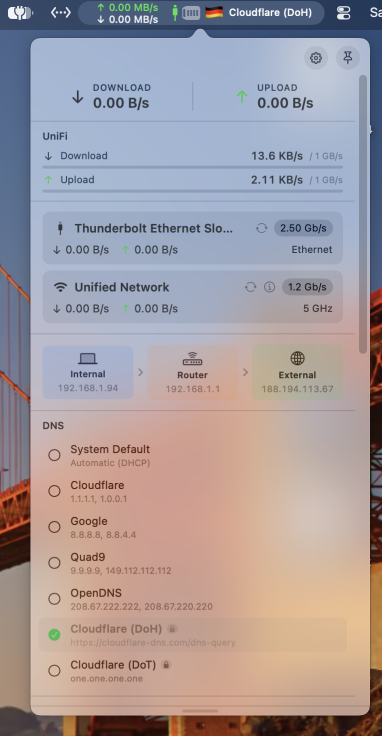

## Encrypted DNS: DNS-over-HTTPS and DNS-over-TLS

NetFluss can now switch your Mac or PC to **encrypted DNS**. Next to the familiar presets, the DNS switcher offers **DoH** and **DoT** versions of Cloudflare, Google, Quad9, Mullvad and AdGuard, plus OpenDNS over DoH, and you can add your own DoH or DoT server in Preferences → DNS. Encrypted presets work in the popover and in the automatic DNS rules per Wi-Fi network. They start hidden; show the ones you want in Preferences → DNS.

  

**What it means for your security.** Every website and app first asks a DNS server where to go. Plain DNS sends those questions unencrypted, so anyone on the way can read them, such as the café's Wi-Fi, the hotel network or your provider, and can even answer with a fake address. With DoH or DoT the lookups travel encrypted to the server you chose, and your Mac or PC checks the server's certificate, so they can neither be read nor redirected on the way. The DNS provider itself still sees your lookups, so pick one you trust. Encrypted DNS doesn't hide which addresses you then connect to; that is what a VPN is for.

- **On the Mac** it is built into macOS: no helper, no background service, no local proxy. macOS asks you to switch NetFluss on once in **System Settings → Network → VPN & Filters**, and NetFluss takes you there.
- **On Windows** NetFluss sets it up through its helper: DNS-over-HTTPS on Windows 11, DNS-over-TLS on Windows 11 24H2 and later. Windows 10 has no encrypted DNS, so the presets are greyed out there.
- **A preset you pick by hand stays** until you join another network, and while a hotel or café login page is waiting, encryption pauses so the page can load.
- DNS-over-QUIC is not included: neither macOS nor Windows supports it natively, and NetFluss won't run a proxy in the background for it.

## NetFluss for Windows is out of beta

NetFluss for Windows 2.8 is the **first stable release**. It is **code-signed by Rana GmbH** and has **the same features as the Mac app**: live rates on the taskbar, the popover, Top Apps, Bandwidth Statistics, Speed Test, Network Slice, router monitoring, automatic and now encrypted DNS, and the built-in VPN client.

**From now on, NetFluss for Mac and Windows are released together**, with the same version number and the same release notes. The Windows installers are in the [NetFluss 2.8 for Windows release](https://github.com/rana-gmbh/NetFluss/releases/tag/win-v2.8.0), for x64 and Arm. Installed betas offer the update themselves.

## Lighter on the Mac

- **Top Apps, app statistics and the Network Slice now read the kernel's own network statistics.** NetFluss no longer starts `nettop`, which could take more than a full CPU core on macOS 27 and drained the battery. Thanks to [ninelives233](https://github.com/ninelives233) for the first fix in this direction ([#66](https://github.com/rana-gmbh/NetFluss/pull/66)).
- **Correct per-app download figures.** On macOS 27, `netstat` reports every download twice as large, and the app statistics used it. They now count each connection's real bytes.
- **The fallback for frozen download counters ends by itself** once the counter moves again, instead of running until you quit NetFluss.

## Fixes

- **Windows: the M-Lab speed test measures upload at full speed.** It showed about 1 Mbit/s whatever the connection could do.
- **Windows: updating no longer fails with "DeleteFile failed; code 5"** when NetFluss is installed in Program Files ([#70](https://github.com/rana-gmbh/NetFluss/issues/70)). The helper now has a folder of its own, and an in-app update asks for administrator approval when the installation needs it.
- **Mac: the M-Lab speed test no longer shows 0 Mbit/s for upload** on some Macs ([#64](https://github.com/rana-gmbh/NetFluss/issues/64)).

## Please note

- **Mac:** encrypted DNS needs the one-time switch in System Settings → Network → VPN & Filters.
- **Windows:** encrypted DNS needs the updated helper. NetFluss asks once to update it, which needs administrator approval.
- **Per-app download history** recorded on macOS 27 before 2.8 shows downloads twice as large as they were.

---

**Mac:** macOS 13 or later, universal (Apple Silicon and Intel), signed and notarized.
**Windows:** Windows 10 (version 2004) or later and Windows 11, x64 and Arm, code-signed by Rana GmbH.
